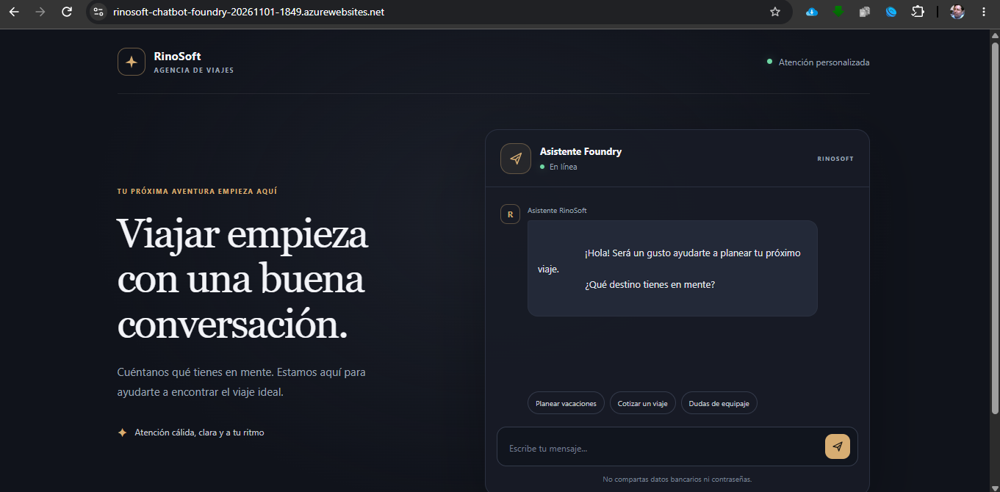
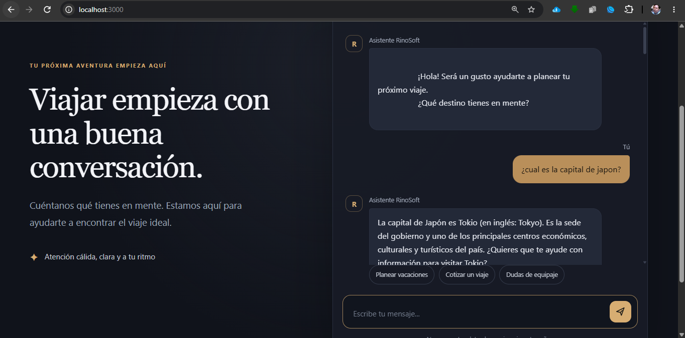
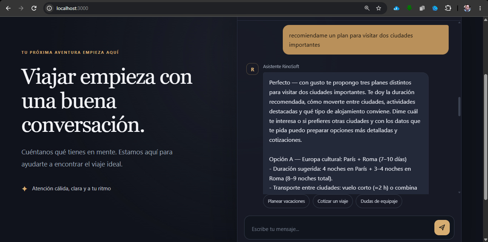
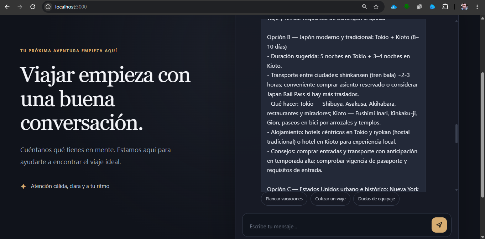
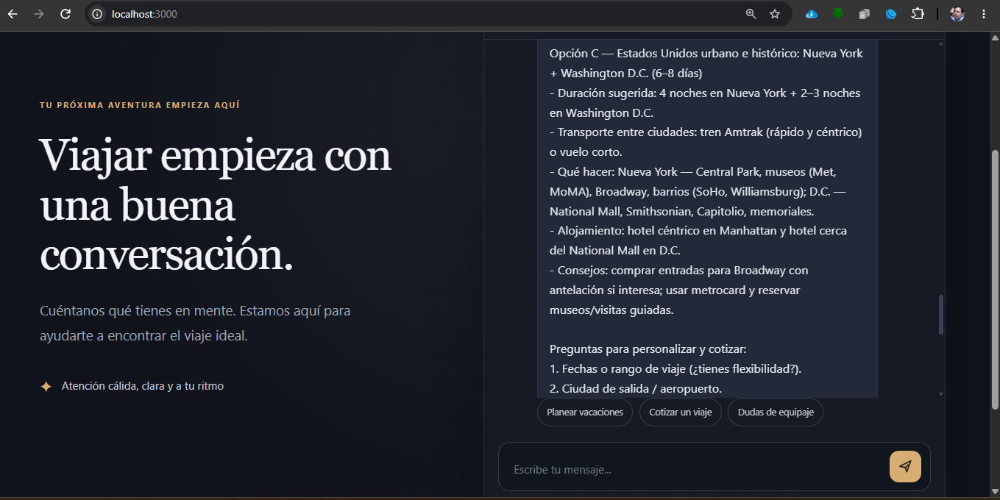
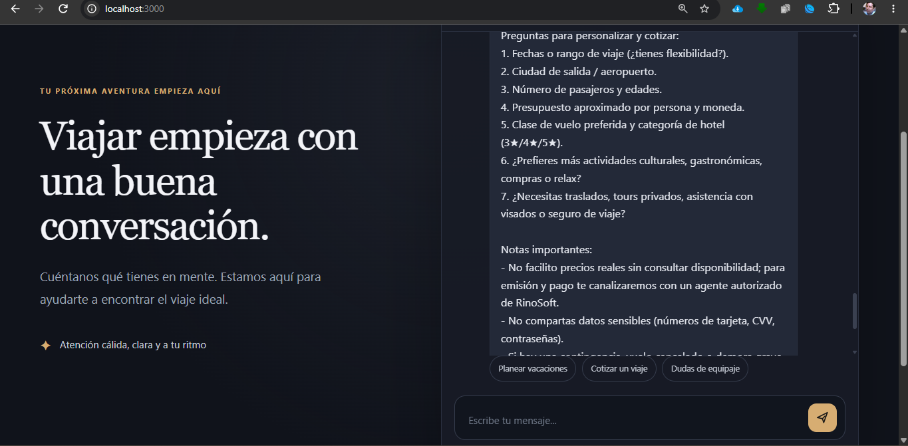

# RinoSoft | Agencia de VIAjes

## Proyecto final para preparación AI-901: Microsoft Azure AI Fundamentals

**Autor:** Raúl Baldomero Neave Guardiola  
**Propuesta:** Implementación de solución de IA para el sector turismo  
**URL pública:** [RinoSoft Agencia de Viajes](https://rinosoft-chatbot-foundry-20261101-1849.azurewebsites.net/)  
**Repositorio Github:** [Repositorio - RinoSoft Agencia de Viajes](https://github.com/RulzNeavz/rinosoft-agencia-viajes)  
**Plataforma:** Microsoft Azure App Service + Microsoft Foundry + Python/FastAPI

---

## 1. Antecedentes

RinoSoft es una agencia de viajes con más de 40 años de experiencia atendido por sus miembros fundadores que elaboran todos sus procesos mediante papel, con la finalidad de materializar las evidencias de trabajo y seguimiento. 

Elementos de análisis: 
- **Información:** Destinos turísticos, facturación, seguimiento, cartera de clientes, alianzas estratégicas, flyers.
- **Procesos:** Seguimiento de clientes, fidelización, satisfacción de viaje, asesoría personalizada.
- **Microsoft Foundry:** Para generar las respuestas sustentadas en el conocimiento determinado en los agentes.
- **Azure App Service:** Para publicar la aplicación en web.

> **Imagen 1.** Aplicación web que recibe al usuario para asesorarlo en su experiencia de viaje.

---
## 2. Objetivos

### Objetivo general

Implementar una propuesta que facilite la operación de la agencia de viajes y permita una rápida respuesta, entendiendo y atendiendo un mercado altamente dinámico. Consolidando su fiel cartera de clientes y atrayendo a nuevos clientes.

### Objetivos específicos

- Alfabetización digital y de uso de IA para los dueños.
- Digitalización de procesos
- Uso de IA como asistente de los procesos de negocio.
- Inclusión de la IA en las operaciones.
- Desarrollar herramientas para la planeación estratégica de RinoSoft Agencia de VIAjes.

---

## 3. Riesgos y estrategias de contención

| Riesgo | Estrategia |
|---|---|
| Rechazo al cambio | Involucrar a los dueños desde el principio y mostrar los beneficios tangibles |
|Dependencia excesiva de IA|Promover la supervisión humana|
|Fuga de datos de clientes|No subir datos sensibles a IA públicas|
|Frustración|Acompañamiento y celebración de logros de uso|
|Costos ocultos|Promover escalamientos|

---

## 4. Desarrollo de la propuesta

### 4.1 Sobre nuestro primer chatbot
De acuerdo con los antecedentes presentados, no se recomienda realizar una aplicación sofisticada, con la intención de que los dueños puedan reconocer el valor que genera la IA en los procesos de negocio.

Por ello, en esta primera fase se propone un asistente tipo chatbot para asesorar a los clientes de la marca. La intención es realizar sugerencias de valor en la experiencia de usuario, para que posteriormente el equipo de ventas de seguimiento puntual de acuerdo con sus necesidades, como se muestra en la siguiente imagen:

> **Imagen 2. Interacción con el chatbot.** Se genera la interacción con el usuario para determinar sus necesidades.

### 4.2 Recomendaciones de itinerarios

El chatbot de acuerdo con la conversación generada permite sugerir a los usuarios diferentes itinerarios de acuerdo con fechas, necesidades, países a visitar y presupuesto.

> **Interacción** El chatbot sugiere de acuerdo con la información proporcionada. Se incluye detalles de no ingresar información sensible.

---

## 5. Conclusiones 

Rinosoft, Agencia de vIAjes no debe implementar la IA solamente porque todos lo hacen, debe de realizarlo de forma ética y organizada considerando lo siguiente:
1. Libera a los dueños de tareas repetitivas;
2. Permite atender más clientes sin contratar más talento;
3. Mejora la experiencia del cliente con respuestas rápidas y personalizadas;
4. Preserva el conocimiento de más de 40 años en la industria.

El secreto recomendado es ir **despacio**, **respetar** el ritmo de los colaboradores y **celebrar** cada pequeño avance. La IA no reemplaza su experiencia; la amplifica.

_**"La tecnología al servicio de la experiencia, no al revés."**_
